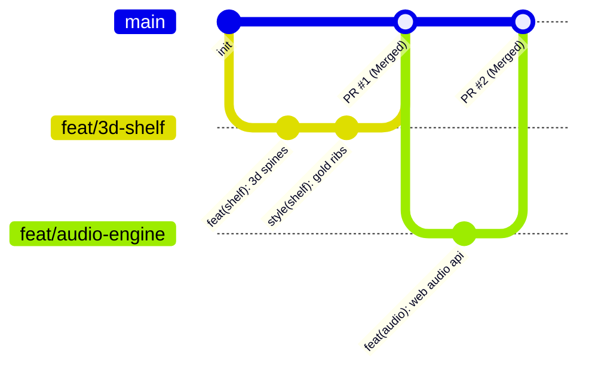

<div align="center">

# 📚 Book Vibe — Cinematic 3D Educational Literature Portal

[](https://book-vibe-shihab.vercel.app/)

[](https://github.com/Atahar-Shihab/Book-Vibe/actions)
[](https://react.dev/)
[](https://vitejs.dev/)
[](https://tailwindcss.com/)
[](https://daisyui.com/)
[](LICENSE)

**An immersive, 3D/4D/5D cinematic open-access literature library, interactive reading analytics studio, and educational exploration portal.**

[🌐 Explore Live Portal](https://book-vibe-shihab.vercel.app/) • [📖 Curated 30 Books](#-30-curated-real-world-educational-books) • [✨ Cinematic Features](#-cinematic-3d--5d-features) • [🔀 Git Workflow](#-git-workflow--pr-conventions) • [🙏 Acknowledgements](#-acknowledgements--attribution) • [⚖️ Intellectual Property](#-intellectual-property--terms-of-use)

</div>

---

> [!TIP]
> **Experience Book Vibe Live on Vercel:**  
> Jump straight into the physical 3D bookshelf, binaural audio soundscapes, and interactive 2,700-year timeline at **[https://book-vibe-shihab.vercel.app](https://book-vibe-shihab.vercel.app/)**.

---

## 🌟 Overview & Educational Mission

**Book Vibe** is an educational literature portal engineered to make reading world-renowned classics captivating, sensory, and accessible to students and lifelong learners. By fusing timeless public-domain literature with 3D browser graphics, Web Audio API synthesis, speech synthesis, and active-recall learning methodologies, Book Vibe elevates literature exploration from flat text into an unforgettable multi-sensory experience.

Every reader has instant access to **30 authentic masterpieces** across classic fiction, Stoic philosophy, astrophysics, and computer science—complete with original analytical commentaries, historical contexts, famous passages, and verified open-access reading links via Project Gutenberg and Open Library.

---

## ✨ Cinematic 3D / 4D / 5D Features

```
                               ┌──────────────────────────────────────────────┐
                               │       Book Vibe Multi-Sensory Portal         │
                               └──────────────────────┬───────────────────────┘
                                                      │
         ┌─────────────────────┬──────────────────────┼──────────────────────┬─────────────────────┐
         ▼                     ▼                      ▼                      ▼                     ▼
┌──────────────────┐  ┌──────────────────┐  ┌──────────────────┐  ┌──────────────────┐  ┌──────────────────┐
│  3D Visual Arts  │  │ 5D Audio Engine  │  │ Historical Canon │  │  Study & Recall  │  │  State & Sync    │
│  - Tilt Physics  │  │  - Binaural Alpha│  │  - 2,700-Yr Era  │  │  - Scholar Notes │  │  - Unmark Read   │
│  - 3D Bookshelf  │  │  - Library Rain  │  │    Timeline      │  │  - 3D Flashcards │  │  - Wishlist Sync │
│  - Flip Reader   │  │  - Hearth Fire   │  │  - 30 Curated    │  │  - Trivia Lab    │  │  - Streak Metric │
│  - Stardust Web  │  │  - Clock Reson.  │  │    Open Classics │  │  - MD Export     │  │  - 4 Themes      │
└──────────────────┘  └──────────────────┘  └──────────────────┘  └──────────────────┘  └──────────────────┘
```

### 1. 📖 3D Physical Bookshelf & Hardcover Spines
* Interactive upright book display with real-time isometric perspective projection (`perspective: 1200px`, `transformStyle: preserve-3d`).
* Textured cloth, leather, and gold foil embossed book spines with variable thickness matching page counts.
* On hover, individual books smoothly slide out forward in 3D space (`translateZ(70px) rotateY(-12deg)`) with cast drop shadows.

### 2. 📖 Interactive 3D Two-Page Flip Reader
* Realistic book reading modal with central book spine crease shadow and vintage parchment paper texture.
* Features drop cap typography, literary quotes, full plot reviews, and direct links to Project Gutenberg & Open Library copies.
* Integrated **AI Voice Narrator** powered by browser Speech Synthesis for hands-free audio listening.

### 3. 🎧 5D Procedural Web Audio Soundscapes (Zero External MP3s!)
Engineered with pure mathematical Web Audio API oscillators, noise generators, and biquad filters:
* **10Hz Binaural Alpha Beats**: Dual-channel stereo detune (200Hz left / 210Hz right) generating calming alpha frequencies for deep cognitive focus.
* **Cozy Library Rain**: Pink noise algorithm modeling raindrops on windowpanes.
* **Hearth Fireplace**: Random spark crackles layered over low-frequency flame rumble.
* **Midnight Grandfather Clock**: Rhythmic woodblock pendulum tick-tock with room air resonance.
* **Real-time Canvas Frequency Visualizer**: Organic wave visualizer reacting to the active soundscape in the navbar.

### 4. 🧭 The Literary Galaxy: 2,700-Year Timeline Explorer
* Chronological visual journey across 5 major intellectual epochs:
  1. *Ancient Wisdom & Epic Poetry* (700 BC – 180 AD)
  2. *Romanticism, Gothic & Existential Realism* (1813 – 1883)
  3. *Modernist Awakenings & Dystopian Visions* (1902 – 1949)
  4. *Post-War Humanism & Cosmic Exploration* (1951 – 1988)
  5. *Cognitive Mastery & 21st Century Canon* (1997 – Present)
* Summarizes the foundational philosophical question of each era with 1-click book exploration.

### 5. ✍️ Scholar Study Journal Studio
* Dedicated reflection workspace for every book with auto-saving to LocalStorage.
* Quick-insert templates: `+ Key Takeaways`, `+ Notable Quote`, `+ Philosophical Reflection`.
* Real-time word and character counters.
* One-click **Markdown (.md) Export** for personal study notes.

### 6. 🃏 3D Active-Recall Flashcard Mastery Deck
* 3D card flip animation (`rotateY(180deg)`) testing key allegories, character motifs, and literary symbolism (e.g., *The Green Light in Gatsby*, *Doublethink in 1984*, *The Allegory of the Cave in Plato's Republic*).
* Progress mastery bar tracking known concepts with celebratory confetti fireworks on completion.

### 7. 🎨 4-Atmosphere Reading Themes
Persistent theme switcher accessible from the navbar:
* **Daylight Library**: Clean white parchment with emerald accents.
* **Moonlight Study**: Deep midnight nebula with glowing violet hues.
* **Antique Parchment**: Vintage linen background with aged sepia ink.
* **Emerald Study**: Botanical dark velvet with gold foil borders.

### 8. ↩️ Complete "Unmark as Read" & Wishlist Reactivity
* Readers can mark books as completed or remove them back to their unread list at any time across BookDetails, Listed Books (`/books`), and individual book cards.
* Synchronizes instantly across browser tabs using custom `bookvibe_storage_updated` window events.

### 9. ⌨️ Spotlight Command Palette (<kbd>Ctrl+K</kbd> / <kbd>⌘K</kbd>)
* Keyboard-driven global search palette allowing instant filtering across 30 books, navigation shortcuts, and audio ambient controls without touching the mouse.

### 10. 📊 3D Cylinder Bar Chart & Reading Velocity
* Visualizes reading milestones using custom glowing 3D cylindrical bars sorted by page volume, star rating, or publication year.
* Tracks daily streaks (`🔥 4 Days`), estimated immersion hours, and unlocks tier ranks up to *Grandmaster of the Canon*.

---

## 📚 30 Curated Real-World Educational Books

All titles are authentic literature works complete with research data, reading times, and verified public domain links:

| # | Title | Author | Year | Category | Difficulty | Est. Time | Open Access |
|---|---|---|---|---|---|---|---|
| 1 | The Great Gatsby | F. Scott Fitzgerald | 1925 | Classic | Intermediate | 4.5 hrs | [Project Gutenberg](https://www.gutenberg.org/ebooks/64317) |
| 2 | To Kill a Mockingbird | Harper Lee | 1960 | Fiction | Intermediate | 7.0 hrs | [Open Library](https://openlibrary.org/works/OL15383568W) |
| 3 | 1984 | George Orwell | 1949 | Science | Intermediate | 8.2 hrs | [Project Gutenberg](https://www.gutenberg.org/ebooks/70652) |
| 4 | The Catcher in the Rye | J.D. Salinger | 1951 | Fiction | Beginner | 5.5 hrs | [Open Library](https://openlibrary.org/works/OL15844883W) |
| 5 | Pride and Prejudice | Jane Austen | 1813 | Classic | Intermediate | 7.5 hrs | [Project Gutenberg](https://www.gutenberg.org/ebooks/1342) |
| 6 | The Hobbit | J.R.R. Tolkien | 1937 | Fantasy | Beginner | 7.8 hrs | [Open Library](https://openlibrary.org/works/OL262758W) |
| 7 | Meditations | Marcus Aurelius | 180 AD | Philosophy | Intermediate | 5.0 hrs | [Project Gutenberg](https://www.gutenberg.org/ebooks/2680) |
| 8 | A Brief History of Time | Stephen Hawking | 1988 | Science | Advanced | 6.5 hrs | [Open Library](https://openlibrary.org/works/OL2163914W) |
| 9 | The Alchemist | Paulo Coelho | 1988 | Philosophy | Beginner | 4.2 hrs | [Open Library](https://openlibrary.org/works/OL1822839W) |
| 10 | Crime and Punishment | Fyodor Dostoevsky | 1866 | Classic | Advanced | 14.0 hrs | [Project Gutenberg](https://www.gutenberg.org/ebooks/2554) |
| 11 | Sapiens: A Brief History | Yuval Noah Harari | 2014 | History | Intermediate | 11.5 hrs | [Open Library](https://openlibrary.org/works/OL17075727W) |
| 12 | Frankenstein | Mary Shelley | 1818 | Classic | Intermediate | 7.0 hrs | [Project Gutenberg](https://www.gutenberg.org/ebooks/84) |
| 13 | Cosmos | Carl Sagan | 1980 | Science | Intermediate | 9.5 hrs | [Open Library](https://openlibrary.org/works/OL15858686W) |
| 14 | The Odyssey | Homer | ~700 BC | Classic | Advanced | 10.0 hrs | [Project Gutenberg](https://www.gutenberg.org/ebooks/1727) |
| 15 | Clean Code | Robert C. Martin | 2008 | Science | Intermediate | 12.0 hrs | [Open Library](https://openlibrary.org/works/OL15846669W) |
| 16 | The Little Prince | Antoine de Saint-Exupéry | 1943 | Philosophy | Beginner | 2.5 hrs | [Open Library](https://openlibrary.org/works/OL27479W) |
| 17 | Brave New World | Aldous Huxley | 1932 | Science | Intermediate | 7.2 hrs | [Open Library](https://openlibrary.org/works/OL15846668W) |
| 18 | Hound of the Baskervilles | Arthur Conan Doyle | 1902 | Mystery | Beginner | 6.0 hrs | [Project Gutenberg](https://www.gutenberg.org/ebooks/2852) |
| 19 | Man's Search for Meaning | Viktor E. Frankl | 1946 | Philosophy | Intermediate | 4.2 hrs | [Open Library](https://openlibrary.org/works/OL15846670W) |
| 20 | The Republic | Plato | ~375 BC | Philosophy | Advanced | 11.0 hrs | [Project Gutenberg](https://www.gutenberg.org/ebooks/1497) |
| 21 | Thinking, Fast and Slow | Daniel Kahneman | 2011 | Science | Advanced | 13.0 hrs | [Open Library](https://openlibrary.org/works/OL15846671W) |
| 22 | Atomic Habits | James Clear | 2018 | Non-Fiction | Beginner | 8.0 hrs | [Open Library](https://openlibrary.org/works/OL17930368W) |
| 23 | Jane Eyre | Charlotte Brontë | 1847 | Classic | Intermediate | 12.5 hrs | [Project Gutenberg](https://www.gutenberg.org/ebooks/1260) |
| 24 | Guns, Germs, and Steel | Jared Diamond | 1997 | History | Advanced | 13.0 hrs | [Open Library](https://openlibrary.org/works/OL15846672W) |
| 25 | The Selfish Gene | Richard Dawkins | 1976 | Science | Advanced | 9.5 hrs | [Open Library](https://openlibrary.org/works/OL15846673W) |
| 26 | Wuthering Heights | Emily Brontë | 1847 | Classic | Intermediate | 10.5 hrs | [Project Gutenberg](https://www.gutenberg.org/ebooks/768) |
| 27 | Fellowship of the Ring | J.R.R. Tolkien | 1954 | Fantasy | Intermediate | 11.0 hrs | [Open Library](https://openlibrary.org/works/OL27480W) |
| 28 | Thus Spoke Zarathustra | Friedrich Nietzsche | 1883 | Philosophy | Advanced | 9.5 hrs | [Project Gutenberg](https://www.gutenberg.org/ebooks/1998) |
| 29 | The Girl on the Train | Paula Hawkins | 2015 | Mystery | Beginner | 7.5 hrs | [Open Library](https://openlibrary.org/works/OL17075728W) |
| 30 | Harry Potter & Stone | J.K. Rowling | 1997 | Fantasy | Beginner | 7.5 hrs | [Open Library](https://openlibrary.org/works/OL82563W) |

---

## 🔀 Git Workflow & PR Conventions

We adhere to enterprise-grade version control standards using a structured Git branching model and Pull Request lifecycle:



### Git Branching Standards:
* `main`: Stable production release branch.
* `feat/<name>`: New capabilities or visual modules.
* `fix/<name>`: Bug fixes and edge-case corrections.
* `docs/<name>`: Documentation, guides, and diagrams.
* `style/<name>`: UI animations, 3D lighting, and CSS enhancements.
* `perf/<name>`: Performance optimizations and bundle reductions.

### Conventional Commit Rules:
```bash
git commit -m "feat(shelf): add 3d perspective book tilt and shadow projections"
git commit -m "fix(audio): handle browser autoplay policy gracefully"
git commit -m "docs(readme): add interactive architecture diagrams"
```

Check out [CONTRIBUTING.md](CONTRIBUTING.md) for full guidelines on opening and merging PRs.

---

## 🛠️ Tech Stack & Architecture

| Layer | Technologies |
|---|---|
| **Core Framework** | [React 19](https://react.dev/) + [React Router v7](https://reactrouter.com/) |
| **Build Engine** | [Vite 8](https://vitejs.dev/) with Fast HMR |
| **Styling & Design System** | [Tailwind CSS v4](https://tailwindcss.com/) + [DaisyUI v5](https://daisyui.com/) |
| **Icons & Visuals** | [Lucide React](https://lucide.dev/) |
| **Procedural Audio** | Native Browser [Web Audio API](https://developer.mozilla.org/en-US/docs/Web/API/Web_Audio_API) + [Web Speech API](https://developer.mozilla.org/en-US/docs/Web/API/Web_Speech_API) |
| **Physics & FX** | Custom HTML5 Canvas Particle Engine + [Canvas Confetti](https://www.npmjs.com/package/canvas-confetti) |
| **Continuous Integration** | GitHub Actions CI (`.github/workflows/ci.yml`) |
| **Hosting & Deployment** | [Vercel](https://vercel.com/) (Live at `book-vibe-shihab.vercel.app`) |

---

## 🚀 Getting Started

### Prerequisites
* Node.js 18.x, 20.x, or 22.x
* npm 9.x or higher

### Installation
```bash
# 1. Clone the repository
git clone https://github.com/Atahar-Shihab/Book-Vibe.git
cd Book-Vibe

# 2. Install dependencies
npm install

# 3. Start development server
npm run dev
```

### Verification & Production Build
```bash
# Run code linting
npm run lint

# Build production bundle
npm run build

# Preview production build locally
npm run preview
```

---

## 🙏 Acknowledgements & Attribution

* **Foundational Curriculum**: Core concept and initial literature platform learning foundation inspired by [Programming Hero](https://web.programming-hero.com/).
* **Engineering & Feature Expansion**: The 3D perspective bookshelf, procedural Web Audio soundscape synthesis (rain, fireplace, 10Hz binaural alpha beats, grandfather clock), 2,700-year historical galaxy timeline, scholar study journal with Markdown export, and active-recall 3D flashcards were independently architected, researched, and engineered using modern React 19 standards and AI pair programming.
* **Public Domain Literature**: Classical texts, chapter excerpts, and open-access links curated from [Project Gutenberg](https://www.gutenberg.org/) and [Open Library](https://openlibrary.org/).

---

## 📄 Intellectual Property & Terms of Use

**Copyright © 2026 Atahar Shihab. All rights reserved.**

This software, including its visual design, 3D animations, Web Audio synthesis algorithms, and original educational curation, is the personal intellectual property of **Atahar Shihab**.

* **Educational Inspection**: Anyone is welcome to clone and run this project locally for personal study, educational review, and non-commercial portfolio evaluation.
* **No Unauthorized Claim or Re-uploading**: You may **NOT** copy, republish, re-host, or claim this project as your own work.
* **No Plagiarism**: Submitting this codebase or substantial portions of its design for academic coursework, competitions, or commercial ventures without explicit written consent is strictly prohibited.

See the full legal terms in [LICENSE](LICENSE).

---

<div align="center">
  <b>Designed and engineered with ❤️ by Atahar Shihab for literature lovers worldwide.</b>
</div>
