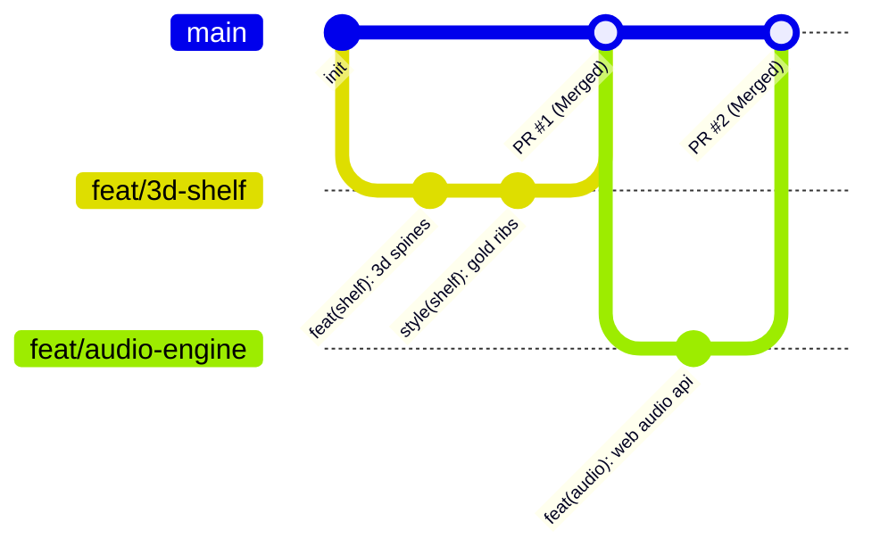

<div align="center">

# 📚 Book Vibe — Cinematic 3D Educational Literature Portal

[](https://github.com/Atahar-Shihab/Book-Vibe/actions)
[](https://react.dev/)
[](https://vitejs.dev/)
[](https://tailwindcss.com/)
[](https://daisyui.com/)
[](https://github.com/Atahar-Shihab/Book-Vibe/pulls)
[](https://opensource.org/licenses/MIT)

**An immersive, 3D/4D/5D cinematic open-access literature library, reading progress visualizer, and educational exploration hub.**

[Explore Live Catalog](#-30-curated-real-world-educational-books) • [Key Features](#-cinematic-3d--5d-features) • [Engineering & Git Standards](#-git-branching--engineering-standards) • [Contributing](CONTRIBUTING.md)

</div>

---

## 🌟 Overview & Educational Mission

**Book Vibe** is an open-source educational platform engineered to make reading world-renowned literature thrilling, accessible, and deeply interactive. By marrying timeless public domain literary works with cutting-edge 3D browser graphics, Web Audio API synthesis, and speech technology, Book Vibe transforms reading from passive consumption into an unforgettable sensory journey.

Every student and reader has instant access to 30 authentic masterpieces across literature, philosophy, astrophysics, and computer science—complete with original literary analyses, chapter excerpts, famous passages, and direct open-access reading links.

---

## ✨ Cinematic 3D / 4D / 5D Features

### 1. 📖 3D Virtual Bookshelf Experience
* Stand upright physical hardcover books on interactive luxury wooden shelves.
* Realistic leather, cloth, and gold foil embossed book spines with variable heights and thicknesses.
* True 3D perspective depth (`perspective: 1200px`, `transformStyle: preserve-3d`): hovering smoothly pulls any book forward in 3D space (`translateZ(70px) rotateY(-12deg)`), accompanied by natural lighting cast shadows.

### 2. 🌌 4D/5D Ambient Canvas Particle Cosmos
* Hardware-accelerated canvas particle simulation rendering ethereal floating stardust, glowing literary runes, and connecting constellations.
* Dynamic cursor repulsion physics and breathing opacity cycles simulate a living, breathing literary atmosphere.

### 3. 🎧 Procedural Web Audio API Soundscapes (Zero External Audio Assets!)
* **Paper Rustle Page Flip**: Synthesized realistic acoustic paper friction using filtered pink noise and exponential decay envelopes.
* **Cozy Library Rain**: Procedurally generated soothing white/pink rain audio.
* **Hearth Fireplace Crackle**: Authentic random spark pops and low ambient flame rumble.
* **Crystalline Success Chimes**: Multitonal synthesized frequencies on adding books to Read or Wishlist.

### 4. 🗣️ Native AI Text-to-Speech Narrator
* Browser Speech Synthesis integration allows readers to listen to full book synopses, literary quotes, and chapter excerpts out loud with a single click.

### 5. 🎴 3D Perspective Tilt Physics with Specular Glare
* Every book card calculates mouse coordinates to apply realistic multi-axis rotation (`rotateX`, `rotateY`, `scale3d`).
* A dynamic radial specular glare sheen follows the cursor across the book cover, replicating real-world laminate gloss reflection.

### 6. 📖 Interactive 3D Two-Page Flip Reader Modal
* Open any book in a realistic two-page reader with central book crease shadow, vintage paper parchment styling, drop cap first letters, and one-click audio narration.

### 7. 📊 3D Custom Shape Bar Chart & Reading Velocity
* Visualizes pages conquered across your completed library using glowing 3D cylinder columns with embedded page counters and hover tooltips.
* Tracks Reading Streaks (`🔥 4 Days`), Estimated Immersion Hours, and Literary Scholar Ranks.

### 8. 🏆 Literary Knowledge Trivia Lab
* Interactive 5-question literary challenge testing knowledge on classics, authors, and historical contexts.
* Instant educational explanations and celebratory confetti fireworks (`canvas-confetti`) upon mastery!

---

## 📚 30 Curated Real-World Educational Books

| # | Title | Author | Year | Category | Difficulty | Est. Time | Open Access |
|---|---|---|---|---|---|---|---|
| 1 | The Great Gatsby | F. Scott Fitzgerald | 1925 | Classic | Intermediate | 4.5 hrs | [Project Gutenberg](https://www.gutenberg.org/ebooks/64317) |
| 2 | To Kill a Mockingbird | Harper Lee | 1960 | Fiction | Intermediate | 7.0 hrs | [Open Library](https://openlibrary.org/works/OL15383568W) |
| 3 | 1984 | George Orwell | 1949 | Science | Intermediate | 8.2 hrs | [Project Gutenberg](https://www.gutenberg.org/ebooks/70652) |
| 4 | The Catcher in the Rye | J.D. Salinger | 1951 | Fiction | Beginner | 5.5 hrs | [Open Library](https://openlibrary.org/works/OL15844883W) |
| 5 | Pride and Prejudice | Jane Austen | 1813 | Classic | Intermediate | 7.5 hrs | [Project Gutenberg](https://www.gutenberg.org/ebooks/1342) |
| 6 | The Hobbit | J.R.R. Tolkien | 1937 | Fantasy | Beginner | 7.8 hrs | [Open Library](https://openlibrary.org/works/OL262758W) |
| 7 | Meditations | Marcus Aurelius | 180 AD | Philosophy | Intermediate | 5.0 hrs | [Project Gutenberg](https://www.gutenberg.org/ebooks/2680) |
| 8 | A Brief History of Time | Stephen Hawking | 1988 | Science | Advanced | 6.5 hrs | [Open Library](https://openlibrary.org/works/OL2163914W) |
| 9 | The Alchemist | Paulo Coelho | 1988 | Philosophy | Beginner | 4.2 hrs | [Open Library](https://openlibrary.org/works/OL1822839W) |
| 10 | Crime and Punishment | Fyodor Dostoevsky | 1866 | Classic | Advanced | 14.0 hrs | [Project Gutenberg](https://www.gutenberg.org/ebooks/2554) |
| 11 | Sapiens: A Brief History | Yuval Noah Harari | 2014 | History | Intermediate | 11.5 hrs | [Open Library](https://openlibrary.org/works/OL17075727W) |
| 12 | Frankenstein | Mary Shelley | 1818 | Classic | Intermediate | 7.0 hrs | [Project Gutenberg](https://www.gutenberg.org/ebooks/84) |
| 13 | Cosmos | Carl Sagan | 1980 | Science | Intermediate | 9.5 hrs | [Open Library](https://openlibrary.org/works/OL15858686W) |
| 14 | The Odyssey | Homer | ~700 BC | Classic | Advanced | 10.0 hrs | [Project Gutenberg](https://www.gutenberg.org/ebooks/1727) |
| 15 | Clean Code | Robert C. Martin | 2008 | Science | Intermediate | 12.0 hrs | [Open Library](https://openlibrary.org/works/OL15846669W) |
| 16 | The Little Prince | Antoine de Saint-Exupéry | 1943 | Philosophy | Beginner | 2.5 hrs | [Open Library](https://openlibrary.org/works/OL27479W) |
| 17 | Brave New World | Aldous Huxley | 1932 | Science | Intermediate | 7.2 hrs | [Open Library](https://openlibrary.org/works/OL15846668W) |
| 18 | Hound of the Baskervilles | Arthur Conan Doyle | 1902 | Mystery | Beginner | 6.0 hrs | [Project Gutenberg](https://www.gutenberg.org/ebooks/2852) |
| 19 | Man's Search for Meaning | Viktor E. Frankl | 1946 | Philosophy | Intermediate | 4.2 hrs | [Open Library](https://openlibrary.org/works/OL15846670W) |
| 20 | The Republic | Plato | ~375 BC | Philosophy | Advanced | 11.0 hrs | [Project Gutenberg](https://www.gutenberg.org/ebooks/1497) |
| 21 | Thinking, Fast and Slow | Daniel Kahneman | 2011 | Science | Advanced | 13.0 hrs | [Open Library](https://openlibrary.org/works/OL15846671W) |
| 22 | Atomic Habits | James Clear | 2018 | Non-Fiction | Beginner | 8.0 hrs | [Open Library](https://openlibrary.org/works/OL17930368W) |
| 23 | Jane Eyre | Charlotte Brontë | 1847 | Classic | Intermediate | 12.5 hrs | [Project Gutenberg](https://www.gutenberg.org/ebooks/1260) |
| 24 | Guns, Germs, and Steel | Jared Diamond | 1997 | History | Advanced | 13.0 hrs | [Open Library](https://openlibrary.org/works/OL15846672W) |
| 25 | The Selfish Gene | Richard Dawkins | 1976 | Science | Advanced | 9.5 hrs | [Open Library](https://openlibrary.org/works/OL15846673W) |
| 26 | Wuthering Heights | Emily Brontë | 1847 | Classic | Intermediate | 10.5 hrs | [Project Gutenberg](https://www.gutenberg.org/ebooks/768) |
| 27 | Fellowship of the Ring | J.R.R. Tolkien | 1954 | Fantasy | Intermediate | 11.0 hrs | [Open Library](https://openlibrary.org/works/OL27480W) |
| 28 | Thus Spoke Zarathustra | Friedrich Nietzsche | 1883 | Philosophy | Advanced | 9.5 hrs | [Project Gutenberg](https://www.gutenberg.org/ebooks/1998) |
| 29 | The Girl on the Train | Paula Hawkins | 2015 | Mystery | Beginner | 7.5 hrs | [Open Library](https://openlibrary.org/works/OL17075728W) |
| 30 | Harry Potter & Stone | J.K. Rowling | 1997 | Fantasy | Beginner | 7.5 hrs | [Open Library](https://openlibrary.org/works/OL82563W) |

---

## 🌿 Git Branching & Engineering Standards

Book Vibe adheres to industry-standard Git flow, conventional commit semantics, and continuous integration workflows:



### Git Branching Standards:
* `main`: Stable production branch.
* `feat/<name>`: New capabilities or visual effects.
* `fix/<name>`: Bug fixes and performance adjustments.
* `docs/<name>`: Documentation, guides, and diagrams.
* `style/<name>`: CSS animations, 3D lighting, and themes.

### Conventional Commit Rules:
```bash
git commit -m "feat(shelf): add 3d perspective book tilt and shadow projections"
git commit -m "fix(audio): handle browser autoplay policy gracefully"
git commit -m "docs(readme): add interactive architecture diagrams"
```

Check out [CONTRIBUTING.md](CONTRIBUTING.md) for full instructions on opening pull requests.

---

## 🛠️ Tech Stack & Architecture

* **Frontend Framework**: [React 19](https://react.dev/) + [React Router v7](https://reactrouter.com/)
* **Bundler & Build Tool**: [Vite 8](https://vitejs.dev/) with Fast HMR
* **Styling**: [Tailwind CSS v4](https://tailwindcss.com/) + [DaisyUI v5](https://daisyui.com/)
* **Icons & UI Assets**: [Lucide React](https://lucide.dev/)
* **Audio Synthesis**: Native Browser [Web Audio API](https://developer.mozilla.org/en-US/docs/Web/API/Web_Audio_API) + [Web Speech API](https://developer.mozilla.org/en-US/docs/Web/API/Web_Speech_API)
* **Particles & Confetti**: Custom HTML5 Canvas Particle Engine + [Canvas Confetti](https://www.npmjs.com/package/canvas-confetti)
* **Continuous Integration**: GitHub Actions CI (`.github/workflows/ci.yml`)

---

## 🚀 Getting Started

### Prerequisites
* Node.js 18.x or 20.x
* npm 9.x or higher

### Installation
```bash
# 1. Clone the repository
git clone https://github.com/Atahar-Shihab/Book-Vibe.git
cd Book-Vibe

# 2. Install dependencies
npm install

# 3. Start development server
npm run dev
```

### Verification & Production Build
```bash
# Run code linting
npm run lint

# Build production bundle
npm run build

# Preview production build locally
npm run preview
```

---

## 📄 License

Distributed under the MIT License. See [LICENSE](LICENSE) for more information.

---

<div align="center">
  <b>Built with ❤️ for literature lovers, students, and curious minds worldwide.</b>
</div>
